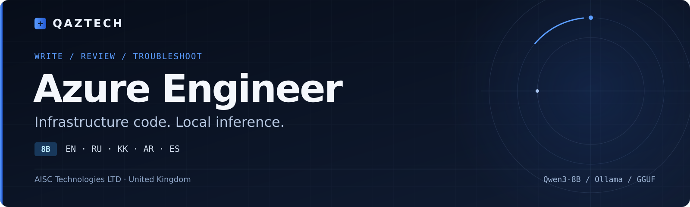

[English](README.md) · [Русский обзор](README.ru.md)

# QAZTECH® Azure Engineer 8B

**Multilingual infrastructure assistance with local inference.**

[](LICENSE)
[](https://huggingface.co/Qwen/Qwen3-8B)
[](https://github.com/qaztech-platform/qaztech-azure/releases/tag/v0.1.0)

[Quick start](#quick-start) · [Model artifacts](#model-artifacts) · [Evaluation](#evaluation) · [Documentation](#documentation)

QAZTECH Azure Engineer 8B writes, fixes, explains and converts infrastructure code, migrates ARM templates to Bicep or Terraform, reviews deployments for cost (FinOps) and troubleshoots failed deployments from error logs. Tools: Azure CLI, Azure PowerShell, Bicep, ARM JSON, Terraform (azurerm, azapi), Azure Policy and custom RBAC roles, KQL, Azure Pipelines and GitHub Actions YAML. This repository contains the complete pipeline that produced the model.

## Choose a QAZTECH model

| Model | Start here when you want to… |
| --- | --- |
| [AZ-104 Tutor 8B](https://github.com/qaztech-platform/qaztech-az104) | Learn Azure concepts and practise certification-style questions with explanations. |
| [Azure Engineer 8B](https://github.com/qaztech-platform/qaztech-azure) | Write, review and troubleshoot Azure infrastructure code. |

Both models target English, Russian, Kazakh, Arabic and Spanish. Language and technical quality vary; see each model's evaluation and limitations.

## Quick start

```bash
ollama run qaztech-platform/azure-engineer
```

## Model artifacts

| Platform | Format | Link |
| --- | --- | --- |
| Hugging Face | Model weights | [QAZTECH-Azure-Engineer-8B](https://huggingface.co/qaztech-platform/QAZTECH-Azure-Engineer-8B) |
| Hugging Face | GGUF Q4_K_M and Q8_0 | [QAZTECH-Azure-Engineer-8B-GGUF](https://huggingface.co/qaztech-platform/QAZTECH-Azure-Engineer-8B-GGUF) |
| Ollama | Local inference | [qaztech-platform/azure-engineer](https://ollama.com/qaztech-platform/azure-engineer) |

## Evaluation

Reported evaluation on 200 held-out examples, with supported code blocks checked using real tools (Azure CLI `--help`, Az PowerShell modules, `bicep build`, `terraform validate` with azurerm 5.10 / azapi 2.13).

| Model | Answer in the right language | Responses with no detected tool-check errors¹ | Code blocks with errors |
|---|---|---|---|
| **QAZTECH Azure Engineer 8B** | 99% | **76%** | 21% |
| Qwen3-8B (base, same prompt) | 98% | 65% | 22% |

¹ This response-level rate uses answers with at least one checked code block as its denominator. The 21% / 22% figures count errors per checked block, so the columns use different denominators. The evaluation is in-distribution; tool checks do not establish factual accuracy or successful deployment.

See the [evaluation methodology](docs/EVALUATION.md), [recorded summary](docs/EVAL_SUMMARY.txt) and [evaluation script](pipeline/eval_models.py).

## Documentation

| Resource | Contents |
| --- | --- |
| [Evaluation](docs/EVALUATION.md) | Reported results, metric definitions and limitations. |
| [Evaluation snapshot](docs/EVAL_SUMMARY.txt) | Original recorded summary, including language breakdowns. |
| [Ollama Modelfile](ollama/Modelfile) | Local build recipe, system prompt and sampling parameters. |
| [Training](training/train.py) | LoRA training implementation. |
| [Pipeline](#pipeline) | Generation, tool validation, repair and evaluation scripts. |

## Pipeline

Data generation used Qwen3-30B-A3B-Instruct-2507 locally and MiniMax M3.1 Flash through Ollama Cloud, with Microsoft Learn code samples (CC BY 4.0). Tool-grounded repair covered 913 examples; the final training dataset contained 4,716 examples. Merged bf16 weights and GGUF artifacts were published through Hugging Face, Ollama, ModelScope and Kaggle.

| Stage | Script | Runs on |
|---|---|---|
| Corpus inventory, modes and prompts | [`pipeline/gen_pilot.py`](pipeline/gen_pilot.py) | DGX Spark |
| Resumable generation (local and cloud teachers, azurerm schema grounding) | [`pipeline/gen_full.py`](pipeline/gen_full.py) | DGX Spark |
| Code validation with real tools | [`pipeline/validate.py`](pipeline/validate.py) | DGX Spark |
| Tool-grounded repair | [`pipeline/repair.py`](pipeline/repair.py) | DGX Spark |
| Dataset build and split | [`pipeline/build_dataset.py`](pipeline/build_dataset.py) | DGX Spark |
| LoRA fine-tuning | [`training/train.py`](training/train.py) | Lambda 1x A100 40 GB |
| Merge adapter into base | [`pipeline/merge.py`](pipeline/merge.py) | DGX Spark (CPU) |
| Held-out evaluation vs base model | [`pipeline/eval_models.py`](pipeline/eval_models.py) | DGX Spark (Ollama) |

Training: LoRA r=16, alpha=32, all linear layers; 3 epochs; lr 1e-4 cosine; effective batch 32; max length 3,072. Held-out eval loss 0.461, token accuracy 0.865.

## Limitations

- **Code can contain errors.** Tool validation checks selected commands, parameters, types and properties; it does not prove runtime correctness or validate all supplied values.
- **Evaluation covers a held-out split from the same data-generation process.** It is not an independent benchmark or a certification result.
- **Language matching is an automated check.** It does not measure fluency or native-speaker quality.
- **Generated commands need review.** Verify against Microsoft Learn and inspect `what-if` / `terraform plan` before applying infrastructure changes.

## Licence

Code and weights: Apache-2.0. Base model Qwen3-8B (Alibaba Cloud, Apache-2.0). Source material: Microsoft Learn documentation (CC BY 4.0). Microsoft and Azure are trademarks of the Microsoft group of companies; Terraform is a trademark of HashiCorp. Not affiliated with or endorsed by Microsoft or HashiCorp. QAZTECH is a registered trade mark of AISC Technologies LTD; see [TRADEMARK.md](TRADEMARK.md).

Developed by AISC Technologies LTD · United Kingdom.
