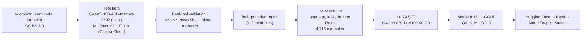

<div align="center">

# QAZTECH® Azure Engineer 8B

**Open multilingual assistant for Azure engineers: EN · RU · KK · AR · ES**

[](LICENSE)
[](https://huggingface.co/qaztech-platform/QAZTECH-Azure-Engineer-8B)
[](https://huggingface.co/qaztech-platform/QAZTECH-Azure-Engineer-8B-GGUF)
[](https://ollama.com/qaztech-platform/azure-engineer)
[](https://huggingface.co/Qwen/Qwen3-8B)

</div>

QAZTECH Azure Engineer 8B writes, fixes, explains and converts infrastructure code, migrates ARM templates to Bicep or Terraform, reviews deployments for cost (FinOps) and troubleshoots failed deployments from error logs. Tools: Azure CLI, Azure PowerShell, Bicep, ARM JSON, Terraform (azurerm, azapi), Azure Policy and custom RBAC roles, KQL, Azure Pipelines and GitHub Actions YAML. This repository contains the complete pipeline that produced the model.

## Try it

```bash
ollama run qaztech-platform/azure-engineer
```

## Evaluation

200 held-out examples; every code block checked with real tools (Azure CLI `--help`, Az PowerShell modules, `bicep build`, `terraform validate` with azurerm 5.10 / azapi 2.13).

| Model | Answer in the right language | Answers with all code valid | Code blocks with errors |
|---|---|---|---|
| **QAZTECH Azure Engineer 8B** | 99% | **76%** | 21% |
| Qwen3-8B (base, same prompt) | 98% | 65% | 22% |

In-distribution evaluation; tools check that commands, flags, parameters, types and properties exist, not their values. Verify commands against Microsoft Learn and run `what-if` / `terraform plan` before applying.

## Pipeline



| Stage | Script | Runs on |
|---|---|---|
| Corpus inventory, modes and prompts | [`pipeline/gen_pilot.py`](pipeline/gen_pilot.py) | DGX Spark |
| Resumable generation (local and cloud teachers, azurerm schema grounding) | [`pipeline/gen_full.py`](pipeline/gen_full.py) | DGX Spark |
| Code validation with real tools | [`pipeline/validate.py`](pipeline/validate.py) | DGX Spark |
| Tool-grounded repair | [`pipeline/repair.py`](pipeline/repair.py) | DGX Spark |
| Dataset build and split | [`pipeline/build_dataset.py`](pipeline/build_dataset.py) | DGX Spark |
| LoRA fine-tuning | [`training/train.py`](training/train.py) | Lambda 1x A100 40 GB |
| Merge adapter into base | [`pipeline/merge.py`](pipeline/merge.py) | DGX Spark (CPU) |
| Held-out evaluation vs base model | [`pipeline/eval_models.py`](pipeline/eval_models.py) | DGX Spark (Ollama) |

Training: LoRA r=16, alpha=32, all linear layers; 3 epochs; lr 1e-4 cosine; effective batch 32; max length 3,072. Held-out eval loss 0.461, token accuracy 0.865.

## Licence

Code and weights: Apache-2.0. Base model Qwen3-8B (Alibaba Cloud, Apache-2.0). Source material: Microsoft Learn documentation (CC BY 4.0). Microsoft and Azure are trademarks of the Microsoft group of companies; Terraform is a trademark of HashiCorp. Not affiliated with or endorsed by Microsoft or HashiCorp. QAZTECH is a registered trade mark of AISC Technologies LTD; see [TRADEMARK.md](TRADEMARK.md).

Developed by AISC Technologies LTD · United Kingdom.
