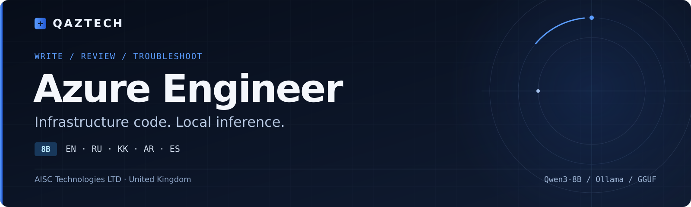

[English](README.md) · **Русский обзор**

# QAZTECH® Azure Engineer 8B

**Мультиязычный помощник по инфраструктуре Azure с локальным запуском.**

Модель пишет, объясняет и исправляет инфраструктурный код, помогает переносить ARM в Bicep или Terraform, анализировать затраты и разбирать ошибки развёртывания. Целевые языки: английский, русский, казахский, арабский и испанский.

Инструменты: Azure CLI, Azure PowerShell, Bicep, ARM JSON, Terraform, Azure Policy, RBAC, KQL, Azure Pipelines и GitHub Actions YAML.

Это русский обзор проекта. Подробное описание конвейера: [English README](README.md).

## Выбор модели

| Задача | Модель |
| --- | --- |
| Практические задачи с инфраструктурным кодом Azure | [Azure Engineer 8B](https://github.com/qaztech-platform/qaztech-azure) |
| Изучение Azure и подготовка к AZ-104 | [AZ-104 Tutor 8B](https://github.com/qaztech-platform/qaztech-az104) |

## Быстрый запуск

При установленном Ollama:

```bash
ollama run qaztech-platform/azure-engineer
```

Пример запроса: «Объясни этот Bicep-файл, проверь типы ресурсов и предложи исправления. Команды и комментарии в коде оставь на английском».

## Модели и форматы

| Платформа | Формат | Ссылка |
| --- | --- | --- |
| Hugging Face | Веса модели | [QAZTECH-Azure-Engineer-8B](https://huggingface.co/qaztech-platform/QAZTECH-Azure-Engineer-8B) |
| Hugging Face | GGUF Q4_K_M и Q8_0 | [QAZTECH-Azure-Engineer-8B-GGUF](https://huggingface.co/qaztech-platform/QAZTECH-Azure-Engineer-8B-GGUF) |
| Ollama | Локальный запуск | [qaztech-platform/azure-engineer](https://ollama.com/qaztech-platform/azure-engineer) |

## Опубликованная оценка

В существующей оценке использованы 200 отложенных примеров на модель. Поддерживаемые блоки кода проверялись инструментами Azure CLI, Az PowerShell, Bicep и Terraform.

| Модель | Проверка языка | Ответы без найденных ошибок в проверенных блоках¹ | Проверенные блоки с ошибками |
| --- | --- | --- | --- |
| QAZTECH Azure Engineer 8B | 99% | 76% | 21% |
| Qwen3-8B, базовая модель | 98% | 65% | 22% |

¹ Доля рассчитывается среди ответов, где проверен хотя бы один блок кода. Показатель ошибок блоков использует другой знаменатель. Проверка языка — эвристика; неопределённый язык скрипт также засчитывает как совпадение. Проценты не означают фактическую точность или успешность развёртывания.

Методика: [docs/EVALUATION.md](docs/EVALUATION.md). Исходная сводка: [docs/EVAL_SUMMARY.txt](docs/EVAL_SUMMARY.txt). Новая оценка при оформлении репозитория не запускалась.

## Документация и конвейер

| Материал | Содержание |
| --- | --- |
| [Оценка](docs/EVALUATION.md) | Определения показателей, исходные результаты и ограничения |
| [Исходная сводка](docs/EVAL_SUMMARY.txt) | Результаты и разбивка по языкам |
| [Ollama Modelfile](ollama/Modelfile) | Рецепт локальной сборки и параметры |
| [Конвейер](README.md#pipeline) | Генерация, проверка инструментами, исправление, обучение и оценка |
| [Обучение](training/train.py) | Реализация LoRA-обучения |

## Ограничения

- Код может содержать ошибки. Проверки охватывают выбранные команды, параметры, типы и свойства; они не доказывают корректность значений и успешность выполнения.
- Отложенная выборка получена тем же процессом генерации данных. Это не независимый бенчмарк и не результат сертификации.
- Автоматическая проверка языка не измеряет естественность речи или качество перевода.
- Проверяйте технические рекомендации по Microsoft Learn, а изменения инфраструктуры — через `what-if` или `terraform plan` до применения.

## Лицензия и авторство

Код и веса: [Apache-2.0](LICENSE). Базовая модель — Qwen3-8B от Alibaba Cloud. Источники — документация Microsoft Learn, CC BY 4.0. Проект не аффилирован с Microsoft или HashiCorp и не одобрен этими компаниями. Условия использования названия QAZTECH: [TRADEMARK.md](TRADEMARK.md).

**AISC Technologies LTD · United Kingdom.** [Вопросы и обратная связь](https://github.com/qaztech-platform/qaztech-azure/issues).
